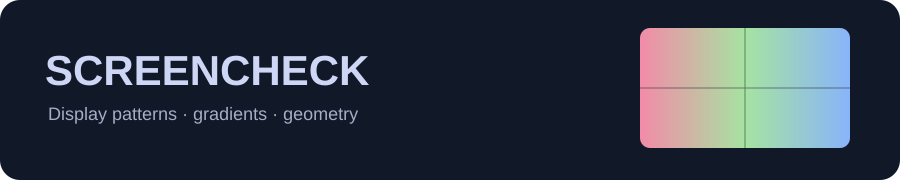

<h1>Screencheck</h1>
A practical test bench for your display.

Launch a local browser-based monitor test suite from one Python file.

## Tests
- Solid black, white, red, green and blue patterns.
- Grayscale ramp and smooth gradient.
- Geometry grid and pointer coordinate readout.
- Fullscreen patterns and custom color.

## Run
    python app.py

Opens http://127.0.0.1:8765. Press Escape to exit fullscreen. Python 3.9+, standard library only. No uploads, tracking or external network requests. Use the monitor's native resolution.